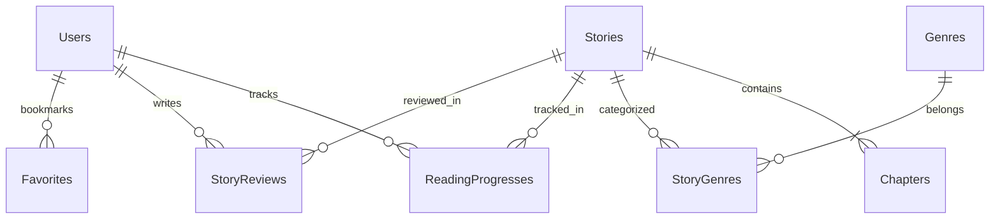

# 🎓 BỘ CÂU HỎI & CÂU TRẢ LỜI VẤN ĐÁP BẢO VỆ ĐỒ ÁN (TOÀN DIỆN)
> **Đề tài:** Hệ Thống Quản Lý & Nền Tảng Đọc Truyện Đa Nền Tảng (StoryReader / StoryNest)  
> **Nhóm thực hiện:** Nhóm 7  
> **Tài liệu chuẩn bị vấn đáp:** Bao quát từ Tổng quan, Kiến trúc, Backend, Frontend, Database, Bảo mật, Caching đến Kỹ thuật Crawler.

---

## 📑 DANH MỤC CÁC PHẦN HỎI ĐÁP
- [PHẦN 1: TỔNG QUAN ĐỀ TÀI & NGHIỆP VỤ (BUSINESS LOGIC)](#phần-1-tổng-quan-đề-tài--nghiệp-vụ-business-logic)
- [PHẦN 2: KIẾN TRÚC HỆ THỐNG & CÔNG NGHỆ (ARCHITECTURE & TECH STACK)](#phần-2-kiến-trúc-hệ-thống--công-nghệ-architecture--tech-stack)
- [PHẦN 3: CƠ SỞ DỮ LIỆU & ENTITY FRAMEWORK CORE (DATABASE & ORM)](#phần-3-cơ-sở-dữ-liệu--entity-framework-core-database--orm)
- [PHẦN 4: XÁC THỰC, PHÂN QUYỀN & BẢO MẬT (AUTH & SECURITY)](#phần-4-xác-thực-phân-quyền--bảo-mật-auth--security)
- [PHẦN 5: HIỆU NĂNG, CACHING & TỐI ƯU GIAO DIỆN (PERFORMANCE & CACHING)](#phần-5-hiệu-năng-caching--tối-ưu-giao-diện-performance--caching)
- [PHẦN 6: KỸ THUẬT CÀO DỮ LIỆU & XỬ LÝ TRUYỆN TRANH (CRAWLER & CDN)](#phần-6-kỹ-thuật-cào-dữ-liệu--xử-lý-truyện-tranh-crawler--cdn)
- [PHẦN 7: DEVOPS, DEPLOYMENT & KHẢ NĂNG MỞ RỘNG (DEPLOYMENT & SCALABILITY)](#phần-7-devops-deployment--khả-năng-mở-rộng-deployment--scalability)
- [PHẦN 8: XỬ LÝ TÌNH HUỐNG HỎI XOÁY ĐÁP XOAY CỦA HỘI ĐỒNG](#phần-8-xử-lý-tình-huống-hỏi-xoáy-đáp-xoay-của-hội-đồng)

---

## PHẦN 1: TỔNG QUAN ĐỀ TÀI & NGHIỆP VỤ (BUSINESS LOGIC)

### Câu 1: Hãy giới thiệu tổng quan về đề tài của nhóm? Mục tiêu và đối tượng hướng đến là ai?
**Trả lời:**
- **Mục tiêu:** Xây dựng một nền tảng đọc truyện trực tuyến hiện đại, mượt mà, hỗ trợ song song 2 hình thức xuất bản: **Truyện chữ (Novel)** và **Truyện tranh (Comic/Manga/Webtoon)** trên cả 2 nền tảng Web và Mobile.
- **Đối tượng:**
  - *Độc giả (Reader):* Tìm kiếm, đọc truyện, theo dõi tiến độ đọc, đánh giá, bình luận, mua chương VIP hoặc gói hội viên.
  - *Quản trị viên (Admin):* Quản lý kho truyện, duyệt chương, phân quyền người dùng, quản lý giao dịch nạp coin và thống kê doanh thu/lượt xem.
- **Giá trị thực tế:** Giải quyết bài toán phân mảnh của các web truyện hiện nay (thường chỉ chuyên truyện chữ hoặc truyện tranh), đồng thời áp dụng kiến trúc Micro-ready với Caching đa tầng giúp hệ thống chịu tải cao.

---

### Câu 2: Hệ thống có những phân hệ và vai trò người dùng (Roles) nào?
**Trả lời:**
Hệ thống sử dụng mô hình Phân quyền theo vai trò (Role-Based Access Control - RBAC) gồm 3 nhóm chính:
1. **Khách vãng lai (Guest / Anonymous):**
   - Xem trang chủ, tìm kiếm, lọc truyện theo thể loại, xem bảng xếp hạng.
   - Đọc các chương miễn phí (`AccessPolicy = 0` hoặc nằm trong số chương `FreeChapterCount`).
2. **Người dùng đã đăng ký (Regular User):**
   - Lưu lịch sử đọc tự động, theo dõi truyện yêu thích (Favorites).
   - Đánh giá (Rating), bình luận (Comments).
   - Nạp Coin vào tài khoản để mở khóa chương trả phí lẻ.
3. **Người dùng VIP (VIP User):**
   - Đọc không giới hạn tất cả các chương VIP có gắn nhãn bảo vệ.
   - Nhận huy hiệu VIP trên giao diện và bình luận.
4. **Quản trị viên (Admin):**
   - Quản trị toàn diện: Thêm, sửa, xóa truyện, duyệt và xuất bản chương mới.
   - Hỗ trợ công cụ thêm nhanh truyện chữ và truyện tranh (nhập danh sách link ảnh).
   - Quản lý người dùng, khóa/mở tài khoản, quản lý cấu hình hệ thống.

---

### Câu 3: Chính sách khóa chương (Access Policy) và kiếm tiền (Monetization) hoạt động như thế nào?
**Trả lời:**
Hệ thống định nghĩa Enum `AccessPolicy`:
- `0 - Free (Miễn phí):` Mọi độc giả đều có thể đọc toàn bộ các chương.
- `1 - Paid (Trả phí / VIP):` Cho phép tác giả/admin thiết lập số chương đọc thử miễn phí (`FreeChapterCount`, ví dụ 3 chương đầu). Từ chương thứ 4 trở đi:
  - Nếu độc giả có gói VIP còn hạn $\rightarrow$ Đọc trực tiếp.
  - Nếu không có VIP $\rightarrow$ Cần dùng Coin để mở khóa chương đó.
- Logic kiểm tra được đóng gói tập trung trong Service `IChapterAccessService.CanReadChapterAsync()`, đảm bảo tính nhất quán giữa Web và Mobile.

---

## PHẦN 2: KIẾN TRÚC HỆ THỐNG & CÔNG NGHỆ (ARCHITECTURE & TECH STACK)

### Câu 4: Tại sao nhóm chọn .NET 8 (ASP.NET Core) làm Backend thay vì Node.js hay Spring Boot?
**Trả lời:**
Nhóm lựa chọn .NET 8 vì 4 ưu điểm vượt trội:
1. **Hiệu năng & Tối ưu luồng (Throughput & Concurrency):** .NET 8 liên tục nằm trong top đầu bảng xếp hạng TechEmpower Benchmarks về khả năng xử lý HTTP requests/giây nhờ Kestrel Web Server và cơ chế `async/await` tối ưu.
2. **Kiểu dữ liệu tĩnh mạnh mẽ (Strongly Typed):** C# 12 kết hợp với Record Types, LINQ và Pattern Matching giúp phát hiện lỗi ngay lúc compile time, giảm thiểu tối đa runtime bugs.
3. **Entity Framework Core 8:** ORM mạnh mẽ hàng đầu hiện nay, hỗ trợ LINQ-to-Entities, migration tự động, tracking queries và compiled queries tốc độ cao.
4. **Hệ sinh thái đồng nhất:** Tích hợp sẵn Dependency Injection, Authentication/Authorization, Logging và Configuration chuẩn mà không cần cài thêm quá nhiều thư viện bên thứ ba như Node.js.

---

### Câu 5: Tại sao Frontend lại dùng React 19 + TypeScript + Vite mà không dùng Next.js hay Vue?
**Trả lời:**
1. **Mô hình Single Page Application (SPA):** Nền tảng đọc truyện chú trọng trải nghiệm đọc liền mạch, chuyển chương tức thì không bị giật/nhấp nháy toàn bộ trang. SPA với React Router v7 đáp ứng hoàn hảo yêu cầu này.
2. **React 19 & TypeScript:** Đảm bảo khả năng bảo trì (maintainability) lâu dài với định kiểu chặt chẽ cho toàn bộ DTOs từ Backend gửi sang Frontend.
3. **Vite 8:** Sử dụng kiến trúc Native ES Modules (ESM) và build bằng Rolldown/esbuild, thời gian khởi động server chỉ mất chưa đến 300ms, HMR (Hot Module Replacement) cập nhật code tức thì trong 10ms.
4. **Tại sao không dùng Next.js (SSR)?** Vì hệ thống đã tích hợp Redis Caching ở Backend và TanStack Query ở Client, tốc độ tải dữ liệu đạt dưới 50ms, trong khi SPA đơn giản hóa việc deploy qua Nginx/Docker mà không cần duy trì Node.js server render SSR phức tạp.

---

### Câu 6: Kiến trúc Backend được tổ chức theo mô hình nào?
**Trả lời:**
Backend được thiết kế theo hướng **Separation of Concerns (Phân tách mối quan tâm)**:
```text
StoryReader.Api/
├── Controllers/         # Tầng tiếp nhận HTTP Request, Validate ModelState, trả về DTO
├── Services/            # Tầng Business Logic (Access Control, Token, Payments)
│   └── Interfaces/      # Khai báo Contract để Dependency Injection (DIP trong SOLID)
├── Models/
│   ├── Entities/        # Thực thể Database (Stories, Chapters, Users, ReadingProgress)
│   ├── Dtos/            # Data Transfer Objects (Request/Response phân tách khỏi Entities)
│   └── Enums/           # StoryType, AccessPolicy, ReleaseStatus, UserRole
└── Data/                # DbContext, Migrations, Fluent API Configurations
```
- **Lợi ích:** Bộ điều khiển (Controller) hoàn toàn "mỏng" (Thin Controller), không chứa logic nghiệp vụ phức tạp. Khi cần thay đổi logic thanh toán hay kiểm tra VIP, chỉ cần sửa đổi trong Service tương ứng mà không làm ảnh hưởng tầng API.

---

## PHẦN 3: CƠ SỞ DỮ LIỆU & ENTITY FRAMEWORK CORE (DATABASE & ORM)

### Câu 7: Trình bày cấu trúc Cơ sở dữ liệu của dự án? Các bảng chính và quan hệ giữa chúng?
**Trả lời:**
Hệ thống sử dụng PostgreSQL 16 với các bảng cốt lõi:
1. `Users`: Lưu thông tin tài khoản, mật khẩu băm, Role, số dư Coin, trạng thái VIP (`VipExpirationDate`).
2. `Stories`: Thông tin truyện (Title, Author, CoverImageUrl, Description, Type, AccessPolicy, ViewCount).
3. `Chapters`: Từng chương truyện (StoryId, ChapterNumber, Title, Content, PublishAt, ViewCount).
   - Quan hệ: `Stories` (1) - `Chapters` (N), xóa Story sẽ xóa liên hoàn (Cascade Delete) các Chapters.
4. `Genres` & `StoryGenres`: Quản lý danh mục thể loại truyện.
   - Quan hệ: N-N giữa `Stories` và `Genres` thông qua bảng trung gian `StoryGenres` (`StoryId`, `GenreId`).
5. `ReadingProgresses`: Lưu lịch sử và tiến độ đọc của từng User với từng Story (`UserId`, `StoryId`, `LastChapterId`, `UpdatedAt`).
6. `StoryReviews` & `Favorites`: Quản lý đánh giá sao, bình luận và danh sách theo dõi.



---

### Câu 8: Tại sao nhóm không tách 2 bảng riêng: `NovelStories` và `ComicStories`?
**Trả lời:**
Nhóm đã cân nhắc kỹ và quyết định **dùng chung một bảng `Stories` với trường phân loại `Type` (Single Table Inheritance pattern)** vì:
1. **Tính tương đồng nghiệp vụ cao (>90%):** Dù là truyện chữ hay truyện tranh, chúng đều có chung các thuộc tính: Tiêu đề, Tác giả, Ảnh bìa, Tóm tắt, Danh sách thể loại, Lượt xem, Đánh giá, Số chương, và Lịch sử đọc.
2. **Tối ưu hóa các câu truy vấn phức hợp:**
   - Khi hiển thị trang chủ, bảng xếp hạng Top View, hoặc tìm kiếm toàn trang, hệ thống chỉ cần truy vấn một bảng duy nhất `Stories` thay vì phải `UNION` hai bảng riêng biệt.
3. **Linh hoạt hiển thị:** Khi lọc thể loại hoặc tab "Tất cả", "Truyện chữ", "Truyện tranh", chỉ cần thêm điều kiện `WHERE "Type" = @type`.
4. **Nội dung chương (`Chapters.Content`):**
   - Với truyện chữ: lưu text thuần.
   - Với truyện tranh: lưu danh sách URL ảnh phân tách bằng dấu `\n`.
   - Cấu trúc này tối giản, không tạo cột thừa (sparse columns) và đạt chuẩn chuẩn hóa cơ sở dữ liệu (Database Normalization).

---

### Câu 9: Tại sao dùng UUID (Guid) làm Khóa chính (Primary Key) thay vì Auto Increment ID (1, 2, 3...)?
**Trả lời:**
Nhóm sử dụng `Guid.NewGuid()` / `gen_random_uuid()` vì 3 lý do bảo mật và kiến trúc:
1. **Chống tấn công thu thập dữ liệu (ID Enumeration / Scraping Attack):** Nếu dùng ID tăng dần `1, 2, 3`, đối thủ có thể dễ dàng đoán URL `api/stories/1`, `api/stories/2` để cào trộm toàn bộ database hoặc biết được hệ thống có tổng cộng bao nhiêu người dùng. Với UUID ngẫu nhiên (ví dụ `3d7c4b6e-3d00-4133-9ccf-d5ab06fcd33b`), việc đoán ID là bất khả thi ($2^{128}$ khả năng).
2. **Khả năng phân tán (Distributed System):** Client hoặc Service nền có thể tự sinh ID trước mà không cần chờ DB trả về kết quả `INSERT`.
3. **An toàn khi Merge dữ liệu:** Khi chuyển dữ liệu giữa các môi trường Test và Production không bao giờ lo trùng khóa chính.

---

### Câu 10: Làm thế nào để giải quyết vấn đề tranh chấp (Concurrency) khi tăng lượt xem hoặc trừ Coin của User?
**Trả lời:**
1. **Lượt xem chương (View Counting):**
   - Không thực hiện ghi trực tiếp đè giá trị tĩnh mà sử dụng biểu thức tăng nguyên tử (Atomic Increment) hoặc đưa qua Redis Cache (`INCR story:{id}:views`), sau đó có Background Worker gom dữ liệu (Batching) cập nhật định kỳ vào DB.
2. **Giao dịch trừ Coin (Payment Transaction):**
   - Sử dụng `IDbContextTransaction` của EF Core với mức cô lập giao dịch (Transaction Isolation Level).
   - Kiểm tra điều kiện số dư: `UPDATE "Users" SET "Coins" = "Coins" - @price WHERE "Id" = @userId AND "Coins" >= @price`. Nếu số dòng ảnh hưởng = 0 nghĩa là số dư không đủ, hệ thống tự động Rollback giao dịch.

---

## PHẦN 4: XÁC THỰC, PHÂN QUYỀN & BẢO MẬT (AUTH & SECURITY)

### Câu 11: Cơ chế Authentication của hệ thống hoạt động như thế nào?
**Trả lời:**
Hệ thống sử dụng cơ chế **JWT (JSON Web Token) kết hợp Token Rotation**:
1. **Khi đăng nhập thành công:**
   - Backend phát hành:
     - `AccessToken`: Thời hạn ngắn (15 - 60 phút), chứa Claims (`sub`, `name`, `role`). Dùng để gửi kèm Header `Authorization: Bearer <token>` trong mỗi request.
     - `RefreshToken`: Thời hạn dài (7 - 30 ngày), mã ngẫu nhiên bảo mật lưu trong database gắn với User.
2. **Khi Access Token hết hạn:**
   - Axios Interceptor trên Frontend bắt mã lỗi `401 Unauthorized`.
   - Tự động gọi endpoint `POST /api/auth/refresh-token` gửi Refresh Token lên.
   - Backend kiểm tra hợp lệ $\rightarrow$ cấp Access Token mới $\rightarrow$ Frontend tự động thực hiện lại request dang dở mà người dùng không hề bị gián đoạn hay bị đăng xuất.

---

### Câu 12: Mật khẩu người dùng được lưu trữ như thế nào? Có an toàn không?
**Trả lời:**
- Mật khẩu **tuyệt đối không bao giờ lưu dưới dạng văn bản thuần (plaintext)**.
- Hệ thống sử dụng thuật toán băm chậm có muối (Salted Slow Hashing Algorithm) như **BCrypt** hoặc **PBKDF2 with HMAC-SHA256**:
  - Mỗi tài khoản có một chuỗi muối (Salt) ngẫu nhiên riêng biệt, ngăn chặn hoàn toàn tấn công dùng Bảng cầu vồng (Rainbow Table).
  - Thuật toán có yếu tố độ phức tạp (Work Factor), làm chậm quá trình thử của kẻ tấn công (Brute-force) xuống hàng triệu lần.

---

### Câu 13: Hệ thống phòng chống các lỗ hổng bảo mật phổ biến (OWASP Top 10) như thế nào?
**Trả lời:**
1. **SQL Injection:**
   - 100% các câu truy vấn thông qua Entity Framework Core đều được tham số hóa tự động (Parameterized Queries).
2. **Cross-Site Scripting (XSS):**
   - React tự động mã hóa (escape) tất cả các biến chuỗi khi render ra DOM.
   - Nội dung mô tả truyện được làm sạch thẻ HTML nguy hiểm trước khi lưu và hiển thị.
3. **Cross-Origin Resource Sharing (CORS):**
   - Backend cấu hình `CorsPolicy` nghiêm ngặt trong `Program.cs`, chỉ cho phép các domain Frontend được phê duyệt truy cập API.
4. **Bảo vệ bản quyền nội dung truyện chữ (Content Leech Protection):**
   - Giao diện đọc truyện khóa sự kiện chuột phải (`contextmenu`), chặn bôi đen văn bản (`user-select: none`), vô hiệu hóa các phím tắt sao chép `Ctrl+C`, `Ctrl+U`, `F12`.

---

## PHẦN 5: HIỆU NĂNG, CACHING & TỐI ƯU GIAO DIỆN (PERFORMANCE & CACHING)

### Câu 14: Vai trò của Redis trong hệ thống là gì? Dữ liệu nào được lưu trong Redis?
**Trả lời:**
Redis đóng vai trò là **In-Memory Cache Layer**, nằm giữa Backend API và PostgreSQL:
1. **Dữ liệu được Cache:**
   - Danh sách thể loại (`genres_list`): Rất ít khi thay đổi, cache với thời gian dài.
   - Bảng xếp hạng Top truyện hot / Xem nhiều (`ranking:views:weekly`): Dữ liệu tính toán nặng, được cache 15-30 phút.
   - Chi tiết truyện cơ bản của các bộ đang "Hot".
2. **Chiến lược Cache (Cache Strategy):**
   - Áp dụng mô hình **Cache-Aside (Lazy Loading)**:
     - Ứng dụng kiểm tra Redis trước. Nếu có (Cache Hit) $\rightarrow$ trả về ngay (thời gian phản hồi < 2ms).
     - Nếu không có (Cache Miss) $\rightarrow$ truy vấn PostgreSQL $\rightarrow$ lưu kết quả vào Redis với thời hạn TTL $\rightarrow$ trả về cho client.
   - **Cache Invalidation:** Khi Admin cập nhật thông tin truyện, hệ thống tự động xóa khóa cache liên quan để đảm bảo dữ liệu không bị cũ (Stale Data).

---

### Câu 15: Tại sao nhóm dùng TanStack Query (React Query) ở Frontend thay vì `useEffect` thông thường?
**Trả lời:**
Nếu chỉ dùng `useEffect` + `useState`:
- Gây hiện tượng request waterfall, tải lại dữ liệu liên tục mỗi khi chuyển trang dù dữ liệu không đổi.
- Khó quản lý trạng thái loading, error, pagination và re-fetching.
Với **TanStack Query v5**:
1. **Client-side Caching tự động:** Khi người dùng đọc lướt qua lại giữa Trang chủ và Chi tiết truyện, dữ liệu lấy từ cache tức thì (0ms).
2. **Stale-While-Revalidate:** Hiển thị dữ liệu cũ ngay lập tức trong khi âm thầm tải dữ liệu mới dưới nền.
3. **Deduplication:** Tự động gom nhiều component gọi chung 1 API thành 1 request duy nhất lên server.

---

### Câu 16: Trình đọc truyện tranh Webtoon được tối ưu như thế nào khi một chương có tới 100 trang ảnh?
**Trả lời:**
1. **Không tải toàn bộ ảnh cùng lúc:** Thuộc tính `loading="lazy"` của trình duyệt kết hợp với `IntersectionObserver` chỉ tải những hình ảnh sắp cuộn tới màn hình.
2. **CDN phân tán (Content Delivery Network):** Ảnh được kéo trực tiếp từ các CDN server phân tán gần người dùng nhất, không đi qua server Backend, giúp máy chủ API không bị nghẽn băng thông.
3. **Tự động giải phóng bộ nhớ (Virtual DOM):** Trình duyệt render ảnh mượt mà, hỗ trợ bộ chọn chương nhanh không cần cuộn lại từ đầu.

---

## PHẦN 6: KỸ THUẬT CÀO DỮ LIỆU & XỬ LÝ TRUYỆN TRANH (CRAWLER & CDN)

### Câu 17: Hãy giải thích luồng hoạt động của Script cào truyện tranh (`tools/crawl_manga.js`)?
**Trả lời:**
Script cào truyện tranh hoạt động theo chu trình khép kín:
1. **Tìm kiếm:** Gửi request lên MangaDex API v5 với từ khóa tên truyện (lọc bỏ các bản Doujinshi, ưu tiên bản chính thức).
2. **Lấy Metadata & Ảnh bìa:** Trích xuất Tiêu đề, Tác giả, Tóm tắt và URL ảnh bìa.
3. **Lấy danh sách chương Tiếng Việt:** Gọi endpoint lấy các chapter có mã ngôn ngữ `vi` (`translatedLanguage[]=vi`).
4. **Trích xuất link ảnh từng trang:** Với mỗi chương, gọi máy chủ `@home server` để lấy danh sách tên file ảnh và mã hash, sau đó ghép thành mảng URL CDN hoàn chỉnh.
5. **Nạp tự động vào Database (`--import`):**
   - Script tự động sinh mã UUID cho truyện.
   - Sinh câu lệnh SQL `INSERT INTO "Stories"` với `Type = 1` (Comic).
   - Sinh câu lệnh `INSERT INTO "Chapters"` với nội dung `Content` là các link ảnh ngắt dòng bằng `\n`.
   - Kết nối trực tiếp vào Docker Container PostgreSQL để thực thi, truyện xuất hiện trên web ngay tức khắc.

---

### Câu 18: Tại sao trước đó script OTruyen bị lỗi và việc chuyển sang MangaDex mang lại lợi ích gì?
**Trả lời:**
- **Nguyên nhân lỗi OTruyen:** Tên miền `otruyenapi.com` bị ngắt kết nối trên hệ thống aaPanel của họ (máy chủ trả về HTTP 404 Domain Unbound).
- **Lợi ích khi đổi sang MangaDex API:**
  - MangaDex là nền tảng mở quốc tế phi lợi nhuận lớn nhất thế giới, hạ tầng server cực kỳ ổn định.
  - Hỗ trợ CORS đầy đủ (trình duyệt không bị lỗi chặn ảnh).
  - Ảnh nguyên gốc chất lượng cao, không bị đóng dấu watermark hay chèn quảng cáo cờ bạc như các trang web lậu tại Việt Nam.

---

### Câu 19: Lưu danh sách link ảnh trong database có rủi ro chết link (Broken Links) không? Cách khắc phục?
**Trả lời:**
- **Rủi ro:** Nếu bên thứ ba đổi cấu trúc CDN hoặc xóa file, link ảnh có thể bị lỗi 404.
- **Cách hệ thống của nhóm xử lý:**
  1. *Ngắn hạn:* MangaDex sử dụng hệ thống CDN phân tán toàn cầu bền vững với mạng lưới server dự phòng.
  2. *Dài hạn (Hướng mở rộng):* Hệ thống có thể bổ sung một Background Service chạy định kỳ tải ảnh về lưu trữ trên **Cloud Object Storage (như AWS S3, Cloudflare R2 hoặc MinIO)** của chính hệ thống, vừa chủ động 100% dữ liệu vừa tối ưu chi phí lưu trữ.

---

## PHẦN 7: DEVOPS, DEPLOYMENT & KHẢ NĂNG MỞ RỘNG (DEPLOYMENT & SCALABILITY)

### Câu 20: Dự án sử dụng Docker như thế nào? Tại sao lại dùng Docker Compose?
**Trả lời:**
Dự án sử dụng `docker-compose.yml` để đóng gói toàn bộ môi trường phụ thuộc:
- **Service 1:** `postgres:16-alpine` (Cổng 5432, mount volume để lưu trữ dữ liệu bền vững).
- **Service 2:** `redis:7-alpine` (Cổng 6379, in-memory cache).
- **Lợi ích:**
  - Khắc phục triệt để lỗi kinh điển: *"Chạy được trên máy em nhưng không chạy được trên máy thầy cô"*.
  - Bất kỳ thành viên nào trong nhóm hoặc giám khảo chỉ cần cài Docker và chạy duy nhất lệnh `docker compose up -d` là toàn bộ cơ sở dữ liệu và cache sẵn sàng trong 10 giây.

---

### Câu 21: Nếu hệ thống có 100.000 người truy cập cùng lúc (High Concurrency), nhóm sẽ nâng cấp hệ thống như thế nào?
**Trả lời:**
Để mở rộng quy mô (Scale-up & Scale-out), nhóm đề xuất chiến lược:
1. **Tầng API (Stateless Service):** Do Backend sử dụng JWT (không lưu session trong bộ nhớ server), ta có thể triển khai nhiều instance API đằng sau một **Load Balancer (Nginx / HAProxy)**.
2. **Tầng Database:**
   - Cấu hình **PostgreSQL Replication (Master - Slave / Read Replicas)**: Master chuyên nhận ghi (Write), 2-3 Read Replicas chuyên phục vụ đọc (Read) để giảm tải 80% áp lực cho Master.
3. **Tầng Caching & Static Assets:**
   - Đưa Redis lên cụm **Redis Cluster**.
   - Phân phối toàn bộ mã nguồn Frontend (HTML, CSS, JS) và Ảnh bìa qua **Cloudflare CDN**.

---

## PHẦN 8: XỬ LÝ TÌNH HUỐNG HỎI XOÁY ĐÁP XOAY CỦA HỘI ĐỒNG

### Câu 22: "Tôi thấy nút Cuộn lên đầu trang và Con mèo linh vật lúc trước nằm đè lên nhau, nhóm đã phát hiện và xử lý như thế nào?"
**Trả lời:**
- **Vấn đề thực tế:** Ở góc dưới bên phải (`bottom-right`), cả nút `ScrollToTop` và `InteractiveMascot` đều sử dụng lớp CSS `fixed bottom-6 right-6 z-40`, dẫn đến tình trạng nút cuộn trang bị che khuất hoàn toàn phía sau chú mèo.
- **Giải pháp xử lý:**
  - Nhóm đã điều chỉnh vị trí nút `ScrollToTop` dịch chuyển sang bên trái với tọa độ `fixed bottom-4 right-20 sm:bottom-5 sm:right-24`.
  - Kết quả tạo thành một cụm tiện ích nổi (Floating Utility Dock) khoa học: nút mũi tên nằm ngay ngắn bên cạnh chú mèo, không còn xung đột click hay bị bong bóng thoại của mèo che mất.

---

### Câu 23: "Nếu tác giả cập nhật chương mới nhưng người đọc vẫn thấy danh sách chương cũ, nguyên nhân do đâu và cách sửa?"
**Trả lời:**
- **Nguyên nhân:** Do dữ liệu danh sách chương của Story đó đang được cache tại Redis hoặc trong bộ nhớ cache của TanStack Query ở trình duyệt.
- **Cách xử lý:**
  - Tại Backend: Khi API `POST /api/stories/{id}/chapters` thêm chương thành công, kích hoạt hàm `_cache.RemoveAsync($"story:{id}:chapters")`.
  - Tại Frontend: Sau khi gọi API thành công, gọi `queryClient.invalidateQueries({ queryKey: ['story', storyId] })` để React Query tự động refetch dữ liệu mới nhất.

---

### Câu 24: "Điểm yếu lớn nhất hiện tại của hệ thống là gì và nhóm dự định khắc phục thế nào?"
**Trả lời:**
*(Trả lời chân thành, khiêm tốn nhưng thể hiện tầm nhìn kỹ thuật rõ ràng)*:
- **Hạn chế:** Hệ thống hiện tại đang phụ thuộc vào link ảnh CDN của nguồn MangaDex bên ngoài. Nếu MangaDex thay đổi chính sách truy cập, một số chương truyện tranh có thể bị gián đoạn.
- **Hướng giải quyết:** Nhóm dự kiến tích hợp **Worker tải ảnh nền (Background Processing via Hangfire / RabbitMQ)** để tự động tải các trang ảnh về lưu trữ trực tiếp trên dịch vụ Cloudflare R2 / AWS S3 của hệ thống, giúp chủ động 100% dữ liệu truyện.

---

## 🎯 BẢNG TỔNG KẾT TỪ KHÓA ĐẮT GIÁ KHI TRẢ LỜI VẤN ĐÁP
| Khái niệm kỹ thuật | Từ khóa chuyên ngành nên dùng |
| :--- | :--- |
| Kiến trúc API | *Stateless, Layered Architecture, RESTful, DTO Pattern, Dependency Injection* |
| Cơ sở dữ liệu | *PostgreSQL, Entity Framework Core, Atomic Update, UUID Primary Key, Cascade Delete* |
| Bảo mật | *JWT Bearer Token, Token Rotation, BCrypt Hashing, RBAC, Parameterized Query, XSS Prevention* |
| Hiệu năng & Cache | *Redis In-Memory, Cache-Aside Pattern, TTL, TanStack Query, Lazy-loading, Webtoon Vertical Scroll* |
| Triển khai | *Docker Compose, Containerization, Environment Variables, Volume Persistence* |
