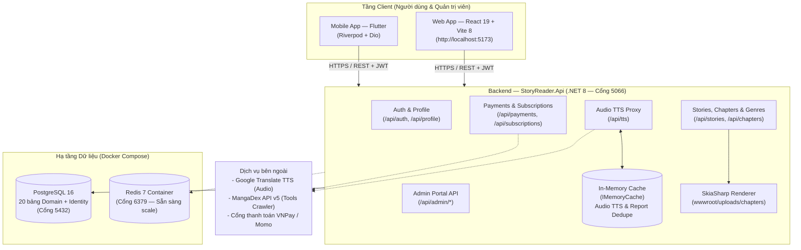
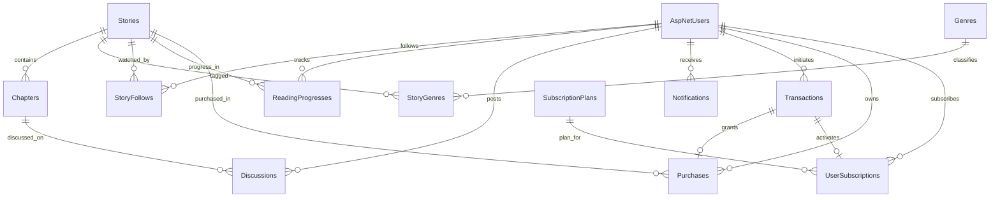
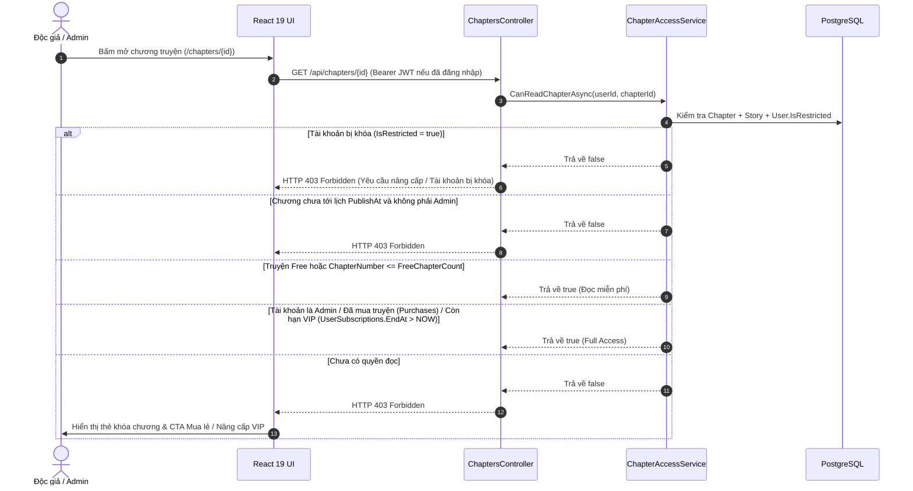
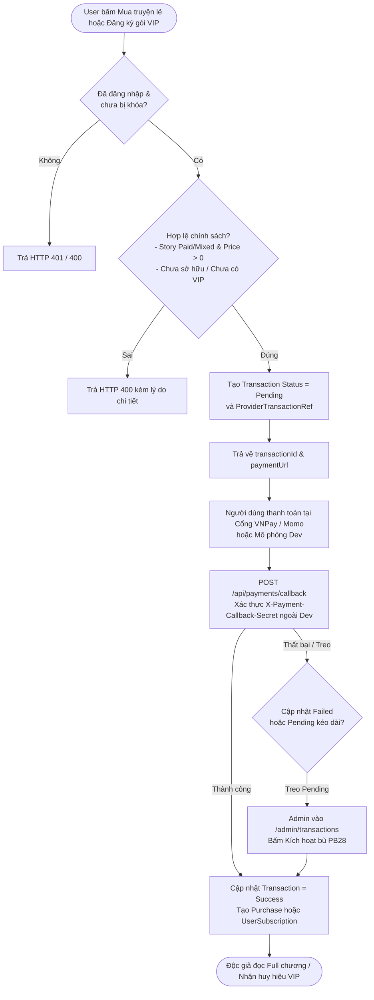
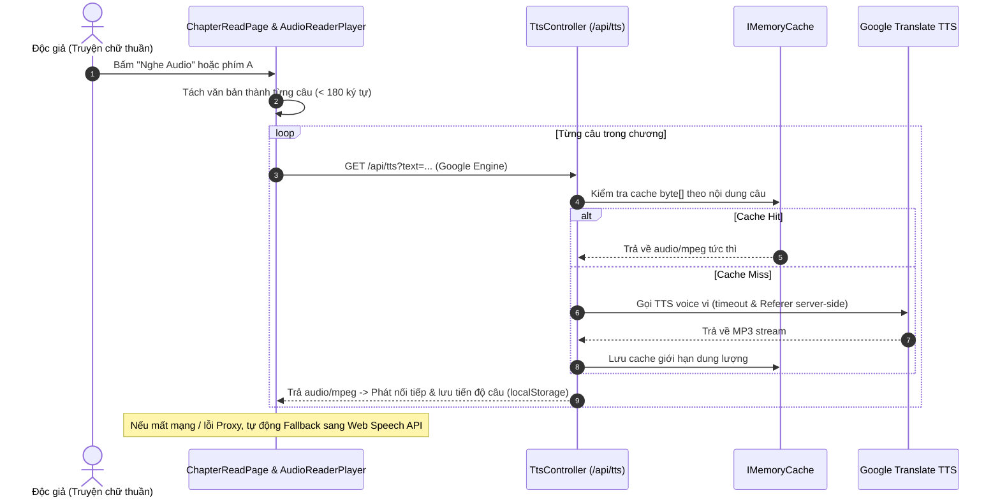
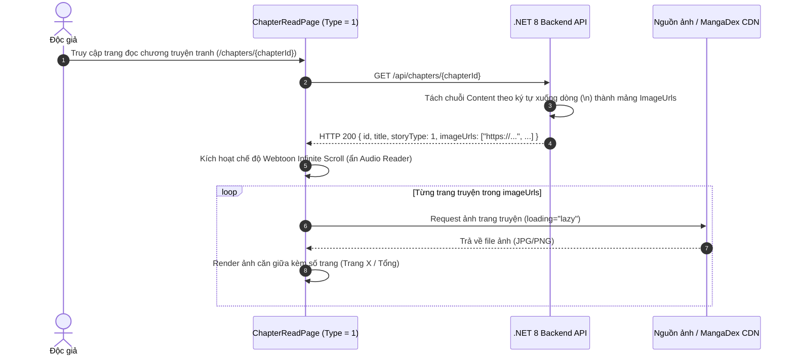
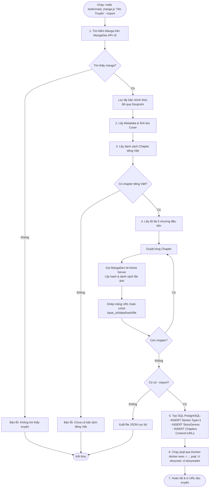

# KIẾN TRÚC CÔNG NGHỆ & SƠ ĐỒ LUỒNG XỬ LÝ — STORYREADER

Tài liệu mô tả kiến trúc kỹ thuật thực tế, lược đồ cơ sở dữ liệu PostgreSQL và các sơ đồ luồng hoạt động chính của hệ thống **StoryReader**.

---

## 1. TỔNG QUAN STACK CÔNG NGHỆ THỰC TẾ

| Tầng (Layer) | Công nghệ thực tế trong mã nguồn | Ghi chú triển khai |
| :--- | :--- | :--- |
| **Backend API** | **.NET 8.0** (ASP.NET Core Web API) | Modular Controllers + Service Layer (`StoryService`, `ChapterAccessService`, `PaymentService`, `AuthService`, `TextToImageService`, `StatsService`) |
| **ORM & Identity** | **EF Core 8.0.10** + **ASP.NET Core Identity** | `AppDbContext : IdentityDbContext<AppUser, IdentityRole<Guid>, Guid>` kết nối PostgreSQL qua `Npgsql.EntityFrameworkCore.PostgreSQL 8.0.10` |
| **Xác thực & Phân quyền** | **JWT Bearer Token** (`8.0.10`) | Claim `NameIdentifier`, `Email`, `displayName`, `Role` (`Admin` / `Member`); kiểm tra khóa tài khoản `IsRestricted` |
| **Bảo vệ & Đa phương tiện** | **SkiaSharp 2.88.8** + **TTS Proxy (`/api/tts`)** | `TextToImageService` render văn bản sang PNG watermark; `TtsController` proxy tiếng Việt kèm `IMemoryCache` |
| **Web Frontend** | **React 19** + **TypeScript 6** + **Vite 8** + **Tailwind CSS 3.4** | Quản lý server state bằng **TanStack Query**, auth state bằng **Zustand** (`authStore`), form bằng **React Hook Form** |
| **Mobile App** | **Flutter** (Dart `^3.12.2`) | State management **Riverpod**, điều hướng **GoRouter**, HTTP client **Dio**, lưu token bằng `flutter_secure_storage` |
| **Database & Cache** | **PostgreSQL 16** + `IMemoryCache` (+ `redis:7` sẵn sàng trong Docker) | PostgreSQL 16 lưu 20 bảng nghiệp vụ & Identity; runtime API đang dùng `IMemoryCache`, container `redis:7` cấu hình sẵn trong `docker-compose.yml` cho bước scale |

---

## 2. KIẾN TRÚC TỔNG THỂ (SYSTEM ARCHITECTURE)



---

## 3. LƯỢC ĐỒ CƠ SỞ DỮ LIỆU THỰC TẾ (POSTGRESQL — 20 BẢNG)

Database `storyreader` sử dụng mô hình **Identity kết hợp Domain Entities** (xác nhận trực tiếp từ `AppDbContext.cs` và PostgreSQL `\dt`):
- **7 bảng Identity chuẩn:** `AspNetUsers` (mở rộng `DisplayName`, `IsRestricted`, `CreatedAt`), `AspNetRoles`, `AspNetUserRoles`, `AspNetUserClaims`, `AspNetRoleClaims`, `AspNetUserLogins`, `AspNetUserTokens`.
- **12 bảng Nghiệp vụ + `__EFMigrationsHistory`:**



---

## 4. CÁC LUỒNG XỬ LÝ CỐT LÕI (CORE FLOWS)

### 4.1. Luồng Xác thực & Phân quyền Đọc Truyện Trả Phí (`ChapterAccessService`)

Khi người dùng gửi yêu cầu `GET /api/chapters/{chapterId}` kèm hoặc không kèm JWT Bearer Token:



---

### 4.2. Luồng Thanh toán Mua Truyện Lẻ / Gói VIP & Kích Hoạt Bù (PB28)

Hệ thống tách bạch rõ **Giao dịch khởi tạo (`Transactions`)** và **Quyền lợi được cấp (`Purchases` / `UserSubscriptions`)** để tránh lỗi mất quyền lợi khi callback chậm:



---

### 4.3. Luồng Nghe Truyện Audio Tiếng Việt (`AudioReaderPlayer` + `/api/tts`)



---

### 4.4. Luồng Hiển thị Truyện Tranh Webtoon (Manga / Comic)



---

## 5. FLOW HOẠT ĐỘNG CỦA SCRIPT CÀO TRUYỆN TỰ ĐỘNG (`tools/crawl_manga.js`)

### 5.1. Tại sao dùng MangaDex API v5 thay cho OTruyen?
- **Vấn đề của nguồn cũ (OTruyen):** Tên miền `otruyenapi.com` trả lỗi `HTTP 404` / unbound domain.
- **Ưu điểm của MangaDex API v5:** Dữ liệu chuẩn quốc tế, có bản dịch tiếng Việt (`translatedLanguage[]=vi`), ảnh chất lượng cao không watermark và cho phép nhúng ảnh từ trình duyệt.

### 5.2. Sơ đồ quy trình Cào và Nạp tự động



---

## 6. FLOW THÊM TRUYỆN & HẸN GIỜ XUẤT BẢN QUA ADMIN

Bên cạnh script tự động, Admin quản lý trực tiếp nội dung và lịch phát hành tại `/admin/stories` và `/admin/schedules`:

```mermaid
sequenceDiagram
    autonumber
    actor Admin as Quản trị viên
    participant Web as AdminStoriesPage & AdminSchedulesPage
    participant API as .NET 8 Backend API
    participant DB as PostgreSQL

    Admin->>Web: Vào /admin/stories -> Thêm truyện & Thêm chương
    Note over Web: Admin chọn xuất bản ngay hoặc đặt PublishAt tương lai\n(Mặc định chương Novel lưu văn bản thuần; có tùy chọn xuất PNG chống copy)
    Web->>API: POST /api/stories/{storyId}/chapters
    API->>API: Chuẩn hóa PublishAt sang UTC (ChapterPublicationHelper.NormalizeUtc)
    API->>DB: INSERT INTO "Chapters"
    alt PublishAt null hoặc <= UtcNow
        API->>DB: Cập nhật Story.UpdatedAt & gửi Notifications cho StoryFollows
    else PublishAt > UtcNow (Hẹn giờ tương lai)
        API->>DB: Chỉ lưu Chapter, KHÔNG gửi thông báo sớm & ẩn khỏi danh sách công khai
        Note over Web,DB: Khi tới giờ PublishAt (ScheduledChapterPublisherWorker quét mỗi phút)\nhoặc Admin bấm "Đăng ngay" tại /admin/schedules,\nAPI cập nhật Story.UpdatedAt và gửi Notifications idempotent cho follower
    end
```

---

## 7. ĐIỂM NỔI BẬT VỀ BẢO MẬT & TỐI ƯU HÓA

1. **Bảo mật truy cập & Thanh toán:**
   - Kiểm tra `ChapterAccessService` ở tầng server cho cả nội dung chương văn bản lẫn danh sách ảnh; khóa bình luận (`IsRestricted`) chặn đồng thời đăng bình luận và đọc truyện trả phí.
   - Endpoint `POST /api/payments/callback` yêu cầu chữ ký `X-Payment-Callback-Secret` so sánh theo thời gian hằng (`CryptographicOperations.FixedTimeEquals`) ngoài môi trường Development.
   - Chống spam báo cáo bình luận: lưu cache `IMemoryCache` theo cặp `(DiscussionId, UserId)` để mỗi người chỉ báo cáo 1 lần trên cùng bình luận; Admin duyệt hợp lệ sẽ reset `ReportCount = 0`.
2. **Bảo vệ bản quyền nội dung (Tùy chọn theo chương):**
   - Chế độ render chữ thành ảnh PNG watermark (`TextToImageService` với `SkiaSharp`) gắn token ngẫu nhiên trên tên file (`/uploads/chapters/{chapterId}/page_001_{token}.png`) chống đoán URL tĩnh.
   - Chế độ đọc web vô hiệu hóa bôi đen/chuột phải ở vùng ảnh truyện tranh & vùng ảnh chống copy.
3. **Tối ưu hiệu năng & Trải nghiệm đọc:**
   - `AdminUsersController` sử dụng join SQL đơn (`UserRoles` join `Roles`) thay vòng lặp `GetRolesAsync` tránh truy vấn N+1.
   - Ảnh truyện tranh tải dần (`loading="lazy"`), Audio TTS được cache byte stream trên server bằng `IMemoryCache`.
   - Giao diện Admin sử dụng Light Theme nhất quán (`#F4F6F9` / `#FFFFFF` / `slate-700..900`) kết hợp điều hướng nhanh giữa Quản lý truyện, Lịch đăng, Báo cáo vi phạm và Giao dịch.
