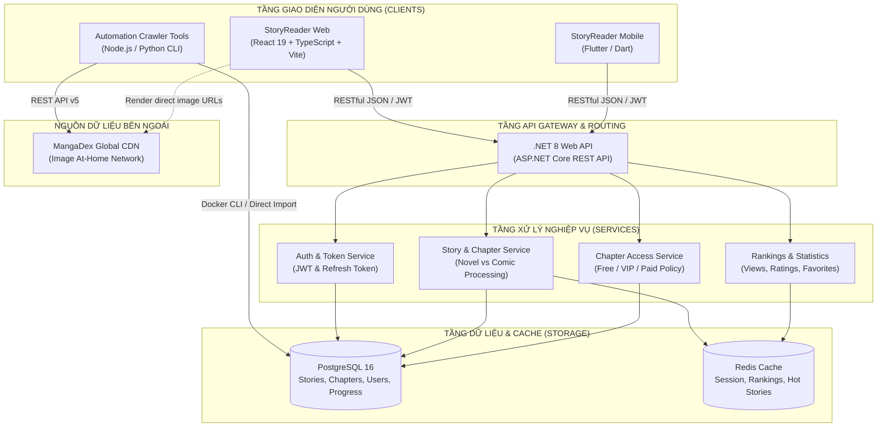
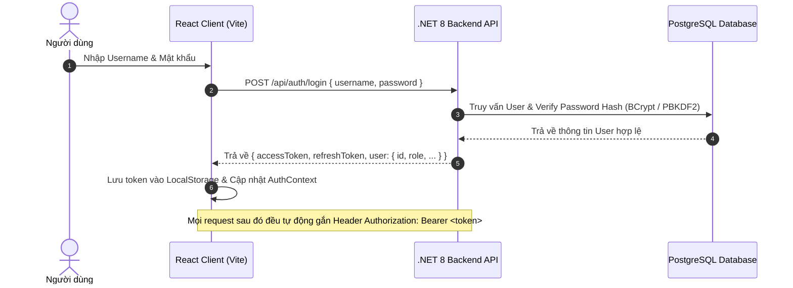
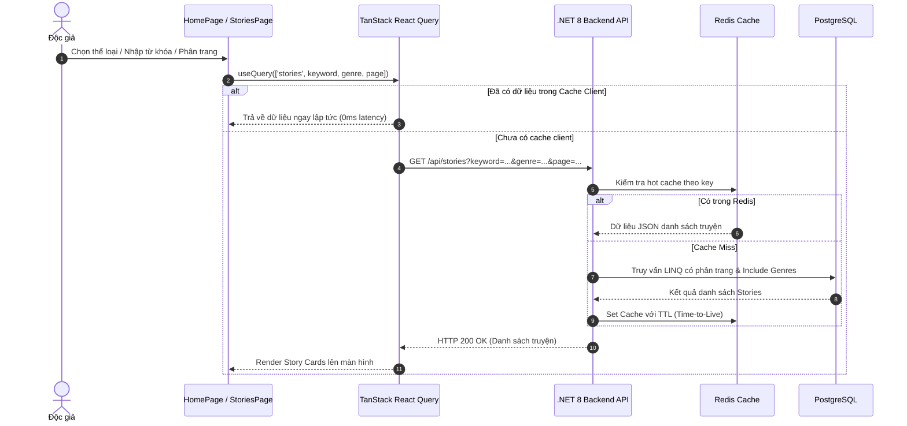
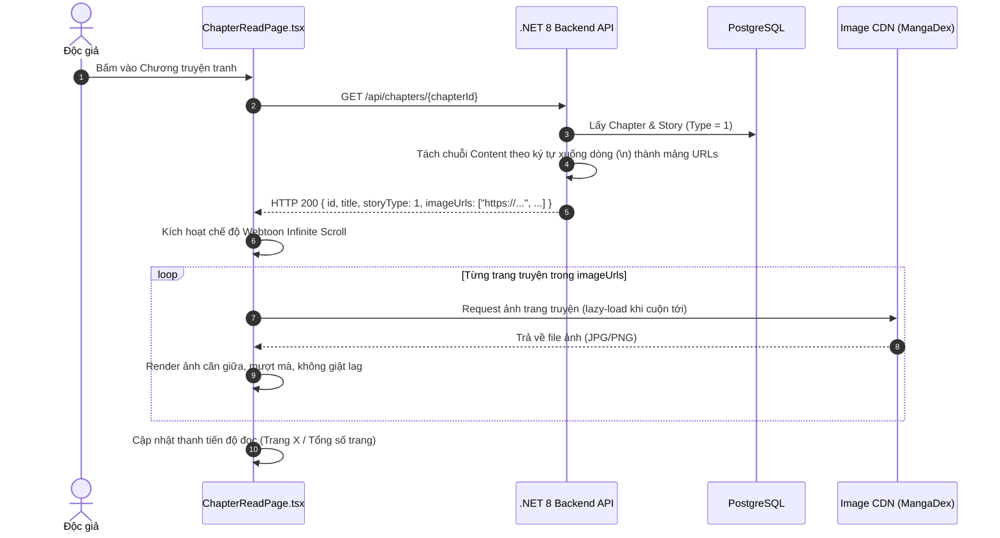
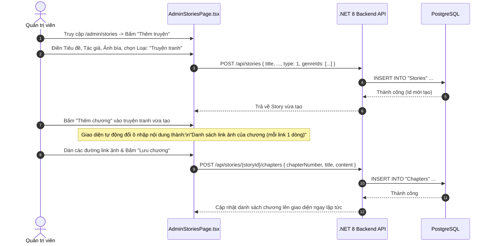

# 📚 KIẾN TRÚC CÔNG NGHỆ & FLOW HOẠT ĐỘNG HỆ THỐNG STORYREADER
> **Hệ Thống Quản Lý Đọc Truyện (Nhóm 7)**  
> *Phiên bản tài liệu kỹ thuật: Tháng 10/2026*

---

## 📑 MỤC LỤC
1. [Tổng Quan Hệ Thống](#1-tổng-quan-hệ-thống)
2. [Chi Tiết Ngăn Xếp Công Nghệ (Tech Stack)](#2-chi-tiết-ngăn-xếp-công-nghệ-tech-stack)
3. [Kiến Trúc Tổng Thể Hệ Thống](#3-kiến-trúc-tổng-thể-hệ-thống)
4. [Flow Hoạt Động Web Đọc Truyện](#4-flow-hoạt-động-web-đọc-truyện)
   - 4.1. [Xác thực & Phân quyền (Authentication & Authorization)](#41-xác-thực--phân-quyền-authentication--authorization)
   - 4.2. [Khám phá & Tìm kiếm Truyện (Story Discovery & Filtering)](#42-khám-phá--tìm-kiếm-truyện-story-discovery--filtering)
   - 4.3. [Luồng Đọc Truyện Chữ (Novel Reader Flow)](#43-luồng-đọc-truyện-chữ-novel-reader-flow)
   - 4.4. [Luồng Đọc Truyện Tranh Webtoon (Comic Reader Flow)](#44-luồng-đọc-truyện-tranh-webtoon-comic-reader-flow)
5. [Flow Hoạt Động Của Script Cào Truyện Tự Động](#5-flow-hoạt-động-của-script-cào-truyện-tự-động)
   - 5.1. [Tại sao chuyển đổi từ OTruyen sang MangaDex API?](#51-tại-sao-chuyển-đổi-từ-otruyen-sang-mangadex-api)
   - 5.2. [Sơ đồ quy trình Cào và Nạp tự động (Crawler & Auto-Import Flow)](#52-sơ-đồ-quy-trình-cào-và-nạp-tự-động-crawler--auto-import-flow)
   - 5.3. [Cơ chế Lưu trữ Dữ liệu Truyện Tranh trong Database](#53-cơ-chế-lưu-trữ-dữ-liệu-truyện-tranh-trong-database)
6. [Flow Thêm Truyện Thủ Công Qua Giao Diện Quản Trị (Admin)](#6-flow-thêm-truyện-thủ-công-qua-giao-diện-quản-trị-admin)
7. [Điểm Nổi Bật Về Tối Ưu Hóa & Bảo Mật](#7-điểm-nổi-bật-về-tối-ưu-hóa--bảo-mật)

---

## 1. TỔNG QUAN HỆ THỐNG
StoryReader (StoryNest) là nền tảng đọc truyện đa nền tảng hiện đại, hỗ trợ song song 2 hình thức xuất bản:
1. **Truyện chữ (Web Novel / Light Novel):** Tối ưu hóa trải nghiệm đọc với các bộ tùy chỉnh font, kích cỡ chữ, giãn dòng, theme (Sáng/Tối/Sepia), bảo vệ bản quyền chống sao chép trái phép.
2. **Truyện tranh (Manga / Comic / Manhwa):** Trình đọc Webtoon cuộn dọc vô tận (Vertical Infinite Scroll), tự động căn chỉnh khung hình, lazy-loading ảnh chất lượng cao và đồng bộ tiến độ đọc.

---

## 2. CHI TIẾT NGĂN XẾP CÔNG NGHỆ (TECH STACK)

### 2.1. Backend API (`StoryReader.Api`)
- **Nền tảng:** .NET 8 (C# 12) - ASP.NET Core Web API.
- **Kiến trúc:** Layered / Clean Architecture tách biệt rõ ràng:
  - `Controllers`: Tiếp nhận request, routing, validate DTOs.
  - `Services`: Business logic (Access Control, VIP Policy, Token Generation, Payment).
  - `Data / Models`: Entity Framework Core DbContext, Entities, Enums.
- **Cơ sở dữ liệu (Database):** **PostgreSQL 16** (quản lý quan hệ thực thể, UUID primary key, full-text search index).
- **Caching & Hiệu năng:** **Redis 7** (lưu trữ cache danh mục, bảng xếp hạng, view counts tạm thời để giảm tải truy vấn DB).
- **Xác thực & Bảo mật:**
  - JWT (JSON Web Tokens) với Access Token & Refresh Token.
  - Phân quyền theo vai trò (Role-based Authorization: `Admin`, `VipUser`, `User`).
- **Containerization:** Docker & Docker Compose orchestrate các dịch vụ PostgreSQL, Redis, PgAdmin.

### 2.2. Frontend Web Client (`storyreader-web`)
- **Framework & Core:** **React 19** kết hợp với **TypeScript** đảm bảo type-safety tuyệt đối.
- **Build Tool:** **Vite 8** (tốc độ khởi động HMR tính bằng mili-giây, tối ưu hóa bundle chunks).
- **Styling & UI:** **Tailwind CSS v4** với thiết kế responsive mobile-first, hỗ trợ đa theme (Dark, Light, Sepia).
- **Quản lý Routing:** **React Router v7** (Nested routes, Protected routes cho Admin, Route guards).
- **Server State Management:** **TanStack React Query v5**:
  - Tự động cache kết quả API, giảm 80% số lượng request trùng lặp.
  - Background refetching, optimistic updates, pagination caching.
- **HTTP Client:** **Axios** với interceptors tự động gắn JWT Bearer token và xử lý refresh token tự động khi hết hạn.
- **Tiện ích & Tương tác:**
  - FontAwesome 6 & Lucide Icons.
  - Canvas-confetti, Web Audio API thuần (hiệu ứng âm thanh Mascot không phụ thuộc file mp3).

### 2.3. Mobile Client (`Storyreader_mobile`)
- **Công nghệ:** **Flutter / Dart** kết nối đồng bộ trực tiếp với cùng một hệ sinh thái Backend REST API.

### 2.4. Công Cụ Cào & Tự Động Hóa Dữ Liệu (`tools/`)
- **Node.js (Native Fetch ES Module)** & **Python 3 (Requests)**.
- **MangaDex Public API v5**: Chuẩn RESTful, cung cấp metadata truyện tranh, phân đoạn chương tiếng Việt (`vi`) và mạng lưới phân phối ảnh CDN At-Home.

---

## 3. KIẾN TRÚC TỔNG THỂ HỆ THỐNG



---

## 4. FLOW HOẠT ĐỘNG WEB ĐỌC TRUYỆN

### 4.1. Xác thực & Phân quyền (Authentication & Authorization)


---

### 4.2. Khám phá & Tìm kiếm Truyện (Story Discovery & Filtering)


---

### 4.3. Luồng Đọc Truyện Chữ (Novel Reader Flow - `Type = 0`)
1. **Kiểm tra quyền truy cập:**
   - Client gọi `GET /api/chapters/{chapterId}`.
   - Backend chạy `IChapterAccessService.CanReadChapterAsync()`:
     - Nếu truyện miễn phí (`AccessPolicy = 0`) $\rightarrow$ Cho phép đọc.
     - Nếu truyện VIP (`AccessPolicy = 1`) $\rightarrow$ Kiểm tra người dùng có mua truyện hoặc có gói VIP còn hạn hay không.
2. **Xử lý nội dung:**
   - Trường `Content` là chuỗi văn bản thuần (plaintext / markdown).
   - Backend trả về `ChapterContentDto` với `storyType: 0` và `imageUrls: []`.
3. **Hiển thị trên giao diện:**
   - Frontend render typography cao cấp: ngắt đoạn tự động, căn chỉnh lề thụt dòng.
   - Cho phép người đọc đổi giao diện Dark/Light/Sepia, tăng giảm cỡ chữ (14px - 28px).
   - Kích hoạt tính năng **bảo vệ chống sao chép**: ngăn chặn chuột phải, chặn phím tắt `Ctrl+C`, `Ctrl+U`, `F12`.

---

### 4.4. Luồng Đọc Truyện Tranh Webtoon (Comic Reader Flow - `Type = 1`)


---

## 5. FLOW HOẠT ĐỘNG CỦA SCRIPT CÀO TRUYỆN TỰ ĐỘNG

### 5.1. Tại sao chuyển đổi từ OTruyen sang MangaDex API?
- **Vấn đề của OTruyen:** Tên miền máy chủ `otruyenapi.com` hiện tại bị dừng hoạt động / unbound domain trên hệ thống aaPanel của họ (trả về lỗi `HTTP 404`).
- **Giải pháp tối ưu từ MangaDex API:**
  - Cung cấp API chuẩn quốc tế, tốc độ cao, không watermark.
  - Có đầy đủ các bản dịch tiếng Việt (`translatedLanguage[]=vi`) cho hàng chục ngàn bộ manga kinh điển (Dragon Ball, One Punch Man, Spy x Family, Conan, One Piece,...).
  - Ảnh phân giải cao, hỗ trợ CORS đầy đủ cho trình duyệt web.

---

### 5.2. Sơ đồ quy trình Cào và Nạp tự động (Crawler & Auto-Import Flow)

```mermaid
flowchart TD
    Start([Bắt đầu: node tools/crawl_manga.js "Tên Truyện" --import]) --> Step1[1. Tìm kiếm Manga trên MangaDex API]
    Step1 --> CheckManga{Tìm thấy manga?}
    CheckManga -- Không --> Err1[Báo lỗi: Không tìm thấy truyện] --> End([Kết thúc])
    CheckManga -- Có --> FilterCanon[Lọc lấy bản chính thức\nBỏ qua Doujinshi]
    
    FilterCanon --> Step2[2. Lấy thông tin Metadata & Ảnh bìa Cover]
    Step2 --> Step3[3. Lấy danh sách Chapter có tiếng Việt]
    Step3 --> CheckChaps{Có chapter tiếng Việt?}
    CheckChaps -- Không --> Err2[Báo lỗi: Chưa có bản dịch tiếng Việt] --> End
    CheckChaps -- Có --> Step4[4. Lấy 5 chương đầu tiên]

    Step4 --> LoopChap[Duyệt từng Chapter]
    LoopChap --> GetServer[Gọi MangaDex At-Home Server\nLấy hash & mảng file ảnh]
    GetServer --> BuildUrls[Ghép chuỗi URLs hoàn chỉnh\nbase_url/data/hash/file]
    BuildUrls --> NextChap{Còn chapter?}
    NextChap -- Có --> LoopChap
    NextChap -- Không --> CheckImport{Có cờ --import không?}

    CheckImport -- Không --> SaveJson[Xuất ra file comic_tên_truyen.json\nLưu trữ cục bộ] --> End
    CheckImport -- Có --> GenSql[5. Khởi tạo câu lệnh SQL chuẩn PostgreSQL:\n- INSERT Stories (Type = 1)\n- INSERT StoryGenres (Manga)\n- INSERT Chapters (Content = URLs ngắt dòng)]
    
    GenSql --> ExecDocker[6. Thực thi lệnh nạp trực tiếp qua Docker:\ndocker exec -i ... psql -U storynest -d storyreader]
    ExecDocker --> Success[7. Thông báo thành công & In link đọc trực tiếp:\nhttp://localhost:5173/stories/{id}] --> End
```

---

### 5.3. Cơ chế Lưu trữ Dữ liệu Truyện Tranh trong Database

Để hỗ trợ cả truyện chữ lẫn truyện tranh mà **không cần sửa đổi cấu trúc bảng** hay gây phân mảnh cơ sở dữ liệu, StoryReader áp dụng mô hình thiết kế linh hoạt:

| Bảng (Table) | Cột (Column) | Giá trị của Truyện Chữ (Novel) | Giá trị của Truyện Tranh (Comic) |
| :--- | :--- | :--- | :--- |
| `Stories` | `Type` | `0` (`StoryType.Novel`) | `1` (`StoryType.Comic`) |
| `Stories` | `CoverImageUrl` | URL ảnh bìa cuốn sách | URL ảnh bìa manga |
| `Chapters` | `Content` | Văn bản văn chương dạng đoạn văn | Danh sách URLs ảnh, mỗi ảnh trên một dòng (`\n`) |
| `Chapters` | `PartName` | Quyển / Hồi / Quyển 1 (tùy chọn) | Tập / Volume (tùy chọn) |

**Ưu điểm vượt trội:**
1. **0 dung lượng lưu trữ ảnh trên máy chủ:** Toàn bộ ảnh được phân phối trực tiếp từ mạng lưới CDN toàn cầu của MangaDex, máy chủ của nhóm không tốn dung lượng ổ cứng để lưu hàng nghìn file ảnh.
2. **Khả năng mở rộng (Scalability):** Hệ thống sẵn sàng chứa hàng triệu chương truyện tranh mà không bị quá tải bộ nhớ.
3. **Tương thích ngược (Backward Compatibility):** Cả ứng dụng Web và Mobile đều có thể đọc dữ liệu từ cùng 1 trường `Content`.

---

## 6. FLOW THÊM TRUYỆN THỦ CÔNG QUA GIAO DIỆN QUẢN TRỊ (ADMIN)

Bên cạnh script tự động, người quản trị có thể thêm và quản lý truyện tranh hoàn toàn trực quan:



---

## 7. ĐIỂM NỔI BẬT VỀ TỐI ƯU HÓA & BẢO MẬT

1. **Trải nghiệm đọc Webtoon mượt mà (Optimized Infinite Scrolling):**
   - Không tải ồ ạt toàn bộ hàng trăm trang ảnh cùng lúc để tránh nghẽn băng thông của người dùng.
   - Trình duyệt tự động kích hoạt `loading="lazy"` kết hợp với preloading 2 trang tiếp theo khi người đọc cuộn tới gần chân trang.
2. **Bộ điều khiển nổi thông minh (Floating Utility Dock):**
   - Nút cuộn lên đầu trang (`ScrollToTop`) và Linh vật tương tác (Mèo Jiji / Thần rừng Totoro) được bố trí lệch nhau (`right-20` và `right-4`), đảm bảo không che khuất tầm nhìn hay xung đột nút bấm.
3. **Cơ chế chống bản quyền nội dung (Content Protection):**
   - Vô hiệu hóa chuột phải, bôi đen, sao chép văn bản đối với truyện chữ.
   - Hiển thị Toast cảnh báo bản quyền sinh động khi phát hiện thao tác cố gắng copy.
4. **Bảo toàn dữ liệu & Toàn vẹn hệ thống:**
   - Sử dụng Docker container hóa toàn bộ môi trường DB và Cache, bảo đảm tính nhất quán trên mọi máy tính phát triển và máy chấm điểm của giảng viên.
