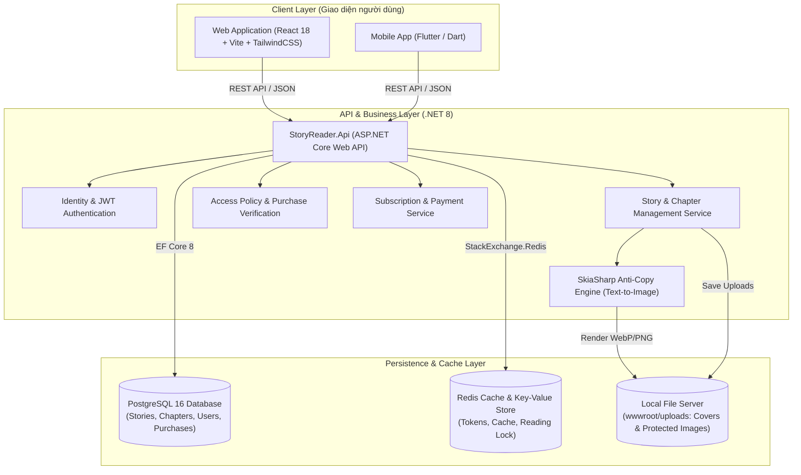

#  Hệ Thống Quản Lý & Đọc Truyện Trực Tuyến - StoryReader

[](https://dotnet.microsoft.com/)
[](https://react.dev/)
[](https://www.typescriptlang.org/)
[](https://tailwindcss.com/)
[](https://www.postgresql.org/)
[](https://redis.io/)
[](https://www.docker.com/)

**StoryReader** là nền tảng quản lý và đọc truyện trực tuyến đa nền tảng (Web & Mobile) hiện đại, hỗ trợ song song **Truyện chữ (Novel)** và **Truyện tranh (Comic/Manga)**. Hệ thống tích hợp **cơ chế bảo vệ bản quyền văn bản độc quyền (Text-to-Image Watermarking SkiaSharp)**, mô hình kinh doanh linh hoạt (Gói VIP đọc không giới hạn hoặc Mua lẻ truyện), cùng bộ công cụ quản trị nội dung chuyên nghiệp.

---

##  Mục Lục
- [1. Kiến Trúc Tổng Thể](#1-kiến-trúc-tổng-thể)
- [2. Công Nghệ Sử Dụng](#2-công-nghệ-sử-dụng)
- [3. Tính Năng Nổi Bật](#3-tính-năng-nổi-bật)
  - [3.1. Dành Cho Độc Giả (Reader Experience)](#31-dành-cho-độc-giả-reader-experience)
  - [3.2. Dành Cho Quản Trị Viên (Admin Portal)](#32-dành-cho-quản-trị-viên-admin-portal)
  - [3.3. Cơ Chế Chống Sao Chép Văn Bản Bản Quyền](#33-cơ-chế-chống-sao-chép-văn-bản-bản-quyền)
- [4. Cấu Trúc Thư Mục Dự Án](#4-cấu-trúc-thư-mục-dự-án)
- [5. Hướng Dẫn Cài Đặt & Khởi Chạy](#5-hướng-dẫn-cài-đặt--khởi-chạy)
- [6. Hướng Dẫn Dùng Script Tự Động Import Truyện](#6-hướng-dẫn-dùng-script-tự-động-import-truyện)
- [7. Tài Khoản Mặc Định Thử Nghiệm](#7-tài-khoản-mặc-định-thử-nghiệm)
- [8. Danh Mục API Chính (REST Endpoints)](#8-danh-mục-api-chính-rest-endpoints)
- [9. Thông Tin Nhóm Thực Hiện](#9-thông-tin-nhóm-thực-hiện)

---

## 1. Kiến Trúc Tổng Thể



---

## 2. Công Nghệ Sử Dụng

| Thành Phần | Công Nghệ / Thư Viện | Mục Đích |
| :--- | :--- | :--- |
| **Backend API** | ASP.NET Core Web API (.NET 8) | Xử lý nghiệp vụ chính, cung cấp RESTful API hiệu năng cao |
| **ORM & Data Access** | Entity Framework Core 8, Npgsql | Thao tác cơ sở dữ liệu quan hệ, tự động migration & seeding |
| **Database** | PostgreSQL 16 | Lưu trữ thông tin tài khoản, tác phẩm, chương, gói cước và giao dịch |
| **In-Memory Cache** | Redis 7 | Lưu trữ token, cache danh mục, quản lý rate limit và session |
| **Bảo mật & Phân quyền** | ASP.NET Core Identity + JWT Bearer | Xác thực người dùng, phân quyền theo vai trò (`Admin`, `Member`, `VIP`) |
| **Xử lý Đồ họa Bản quyền** | SkiaSharp Library | Chuyển đổi nội dung văn bản thành tập ảnh phân đoạn kèm Watermark |
| **Frontend Web** | React 18, TypeScript, Vite | Nền tảng giao diện web tốc độ cao, Single Page Application |
| **Giao diện & UI** | Tailwind CSS v4, FontAwesome 6 | Hệ thống styling hiện đại, tối ưu giao diện Responsive |
| **Data Fetching & Cache** | TanStack React Query v5 | Đồng bộ dữ liệu máy chủ, cache client-side và tự động revalidate |
| **Quản lý State** | Zustand | Lưu trữ trạng thái xác thực và hồ sơ người dùng |
| **Frontend Mobile** | Flutter (Dart) | Ứng dụng di động đa nền tảng (Android & iOS) |
| **Ảo hóa & Triển khai** | Docker, Docker Compose | Khởi tạo môi trường PostgreSQL và Redis đồng nhất trong 1 câu lệnh |

---

## 3. Tính Năng Nổi Bật

### 3.1. Dành Cho Độc Giả (Reader Experience)
- **Khám phá tác phẩm phong phú:**
  - Trang chủ phân loại thông minh: Banner nổi bật (Hero Spotlight), Bảng xếp hạng đọc nhiều (Leaderboard), Truyện mới cập nhật, Lọc theo thể loại.
  - Phân loại trực quan giữa **Truyện chữ (Novel)** và **Truyện tranh (Comic/Manga)**.
  - Thẻ thông tin thể hiện trạng thái phát hành (*Đang phát hành*, *Hoàn thành*), chính sách (*Miễn phí*, *VIP*, *Hỗn hợp*), số chương thực tế và lượt xem.
- **Trình đọc truyện tối ưu (`ChapterReadPage`):**
  - **Đọc truyện chữ:** Tự do tùy biến cỡ chữ (A- / A+), phông chữ, giãn dòng và 3 chủ đề nền: **Sáng (Light)**, **Vàng dịu mắt (Sepia)**, **Tối (Dark)**.
  - **Đọc truyện tranh & Chế độ Chống sao chép:** Cuộn dọc liên tục mượt mà theo chuẩn Webtoon, có hiển thị số thứ tự trang.
  - **Chuyển chương tự động cuộn lên đầu trang:** Loại bỏ cảm giác bị đứng ở cuối màn hình khi chuyển tiếp chương tiếp theo.
  - **Tự động lưu tiến độ đọc (Reading Progress):** Tự động ghi nhớ chương truyện và phần trăm vị trí đang đọc cho từng tài khoản.
- **Tương tác & Theo dõi:**
  - Theo dõi / Đánh dấu tác phẩm (Follow Story), nhận thông báo (Notification) ngay khi có chương truyện mới.
  - Thảo luận và đánh giá số sao (Rating 1-5) trực tiếp dưới từng chương truyện.
- **Gói đọc VIP & Mua lẻ linh hoạt:**
  - Đăng ký gói hội viên VIP (1 tháng, 3 tháng, 12 tháng) đọc không giới hạn toàn bộ kho truyện.
  - Mua lẻ từng bộ truyện (Trả phí 1 lần - đọc vĩnh viễn) với giao diện mô phỏng thanh toán trực quan kèm hiệu ứng pháo hoa chúc mừng.

### 3.2. Dành Cho Quản Trị Viên (Admin Portal)
- **Quản lý danh mục truyện (`/admin/stories`):**
  - Tạo mới tác phẩm dễ dàng, phân chia loại truyện chữ hoặc truyện tranh.
  - **Chỉnh sửa toàn diện thông tin truyện:** Sửa tên truyện, tác giả, mô tả chi tiết (có bộ đếm ký tự trực tiếp), thể loại và trạng thái phát hành.
  - **Hỗ trợ tải ảnh bìa trực tiếp:** Admin có thể tải ảnh bìa trực tiếp từ máy tính (`POST /api/stories/upload-cover`) hoặc dán đường dẫn URL, có **khung xem trước ảnh (Live Preview)** tức thì.
  - **Thao tác nhanh tiện lợi:** 
    - Nút "Sửa" trực tiếp trên từng dòng danh sách bảng truyện.
    - Hover chuột lên ảnh bìa trong Drawer chi tiết để đổi ảnh bìa nhanh.
    - Nút "Sửa mô tả" nhanh ngay đầu khối mô tả truyện.
    - Nút shortcut **"Sửa truyện (Admin)"** xuất hiện ngay trên trang chi tiết truyện phía độc giả giúp Admin truy cập chỉnh sửa tức thì.
- **Quản lý chương truyện:**
  - Thêm, sửa, xóa chương với số thứ tự và tiêu đề tùy biến.
  - Tùy chọn kích hoạt tính năng **bảo vệ bản quyền văn bản (Render as Images)** khi thêm/sửa chương.
- **Quản lý kinh doanh & Giao dịch (`/admin/transactions`):**
  - Theo dõi danh sách giao dịch nạp tiền, mua truyện và mua gói VIP.
  - Phê duyệt thủ công các giao dịch chuyển khoản hoặc hủy đơn hàng không hợp lệ.
- **Quản lý người dùng & Kiểm duyệt (`/admin/users`, `/admin/discussions`):**
  - Xem danh sách thành viên, phân quyền tài khoản Quản trị viên / Độc giả.
  - Kiểm duyệt, ẩn hoặc xóa các bình luận vi phạm tiêu chuẩn cộng đồng.
- **Thống kê tổng quan (`/admin/stats`):**
  - Bảng điều khiển trực quan tổng số tác phẩm, tổng chương, số độc giả đăng ký và lượt đọc toàn hệ thống.

### 3.3. Cơ Chế Chống Sao Chép Văn Bản Bản Quyền
StoryReader áp dụng giải pháp bảo vệ nội dung 3 lớp độc quyền:
1. **Lớp 1 - SkiaSharp Rendering Engine (Backend):** Khi bật chế độ chống sao chép, backend tự động tính toán font chữ, căn chỉnh dòng, vẽ watermark mờ mang thông tin nhận diện hệ thống và xuất thành tập hợp hình ảnh WebP/PNG chất lượng cao. Độc giả không thể quét chọn (copy/paste) nội dung văn bản thô.
2. **Lớp 2 - Bộ lọc màu thích ứng Adaptive CSS (Frontend):** Ứng dụng ma trận CSS Filter (`grayscale`, `brightness`, `contrast` và `mix-blend-mode: multiply`). Các trang ảnh văn bản hòa hợp 100% với màu nền người đọc đã chọn (Light, Sepia hoặc Dark), loại bỏ hoàn toàn viền ảnh và ánh xanh.
3. **Lớp 3 - Vô hiệu hóa DOM:** Vô hiệu hóa bôi đen (`user-select: none`), chặn menu chuột phải (`contextmenu`), chặn các phím tắt sao chép / mở DevTools và phủ lớp màng trong suốt ngăn tải ảnh trái phép.

---

## 4. Cấu Trúc Thư Mục Dự Án

```text
HeThongQuanLyDocTruyen-Nhom-7/
├── StoryReader.Api/                     # [Backend] Mã nguồn ASP.NET Core Web API (.NET 8)
│   ├── Controllers/                     # API Controllers (Stories, Chapters, Profile, Admin...)
│   ├── Data/                            # DbContext, Seeder dữ liệu mẫu và EF Migrations
│   ├── Models/                          # Entities, Data Transfer Objects (DTOs), Enums
│   ├── Services/                        # Business Logic, Chapter Access, TextToImage SkiaSharp
│   ├── Properties/                      # Cấu hình launchSettings.json (Port 5066)
│   ├── appsettings.json                 # Cấu hình chuỗi kết nối Database, Redis, JWT
│   └── wwwroot/                         # File tĩnh: ảnh bìa tải lên (/uploads/covers) và ảnh chương
│
├── storyreader-web/                     # [Frontend Web] Mã nguồn React 18 + Vite + TypeScript
│   ├── src/
│   │   ├── api/                         # Khách hàng gọi API Axios (stories, chapters, auth...)
│   │   ├── components/                  # UI components tái sử dụng (Header, Footer, StoryCard...)
│   │   ├── pages/                       # Trang người dùng & Trang quản trị Admin (AdminStoriesPage...)
│   │   ├── store/                       # Zustand stores (Quản lý Access Token, User Profile)
│   │   └── utils/                       # Tiện ích bổ trợ: resolveImageUrl, confetti...
│   ├── vite.config.ts                   # Cấu hình Vite & reverse proxy /uploads đến API
│   └── package.json                     # Danh sách phụ thuộc và scripts dự án web
│
├── Storyreader_mobile/                  # [Frontend Mobile] Mã nguồn ứng dụng di động Flutter
│   ├── lib/                             # Mã nguồn Dart: features, models, presentation, blocs
│   └── pubspec.yaml                     # Cấu hình dependencies Flutter
│
├── scripts/                             # [Automation] Kịch bản tự động hóa hệ thống
│   └── import_story.ps1                 # Script tự động import truyện nhiều chương từ file .txt
│
├── docker-compose.yml                   # Cấu hình container Docker cho PostgreSQL 16 & Redis 7
└── README.md                            # Tài liệu hướng dẫn dự án StoryReader
```

---

## 5. Hướng Dẫn Cài Đặt & Khởi Chạy

### 5.1. Yêu Cầu Môi Trường
- **.NET SDK:** Phiên bản `8.0` trở lên ([Tải tại đây](https://dotnet.microsoft.com/download/dotnet/8.0))
- **Node.js:** Phiên bản `18.x` hoặc `20.x LTS` ([Tải tại đây](https://nodejs.org/))
- **Docker Desktop:** Để chạy PostgreSQL và Redis ([Tải tại đây](https://www.docker.com/products/docker-desktop/))
- **PowerShell 7 (pwsh):** Hỗ trợ chạy các kịch bản import tự động

---

### 5.2. Bước 1: Khởi Động Hạ Tầng (PostgreSQL & Redis)
Mở cửa sổ dòng lệnh tại thư mục gốc của dự án:
```bash
docker-compose up -d
```
> **Thông số kết nối mặc định:**
> - **PostgreSQL:** `localhost:5432` | DB: `storyreader` | User: `storynest` | Pass: `storynest123`
> - **Redis:** `localhost:6379`

---

### 5.3. Bước 2: Khởi Chạy Backend API (.NET 8)
Mở một cửa sổ dòng lệnh mới và thực thi:
```bash
cd StoryReader.Api
dotnet restore
dotnet run
```
Sau khi khởi động thành công:
- **API Base URL:** `http://localhost:5066/api`
- **Tài liệu Swagger UI:** `http://localhost:5066/swagger`

> *(Hệ thống tự động thực hiện migration và seed dữ liệu khởi tạo: thể loại, truyện mẫu, gói VIP, tài khoản Admin và tài khoản Độc giả).*

---

### 5.4. Bước 3: Khởi Chạy Frontend Web (React + Vite)
Mở một cửa sổ dòng lệnh khác:
```bash
cd storyreader-web
npm install
npm run dev
```
Trang web sẽ sẵn sàng truy cập tại:
- **Trang chủ người dùng:** `http://localhost:5173`
- **Trang Quản trị Admin:** `http://localhost:5173/admin/stories`

---

### 5.5. Bước 4: Khởi Chạy Ứng Dụng Mobile (Flutter - Tùy chọn)
Nếu bạn muốn trải nghiệm trên thiết bị di động hoặc máy ảo:
```bash
cd Storyreader_mobile
flutter pub get
flutter run
```

---

## 6. Hướng Dẫn Dùng Script Tự Động Import Truyện

Dự án cung cấp sẵn kịch bản PowerShell thông minh giúp chuyển đổi file tiểu thuyết văn bản `.txt` thành tập truyện đầy đủ các chương trên hệ thống:

```powershell
pwsh scripts/import_story.ps1 -FilePath "đường_dẫn_đến_file.txt"
```

**Ví dụ thực tế:**
```powershell
pwsh scripts/import_story.ps1 -FilePath "C:\Users\TrMin\Downloads\Tron_Bo_Tieu_Thuyet_Dragon_Ball.txt"
```

**Tính năng của Script:**
- Tự động đăng nhập lấy token quyền Quản trị viên (`admin@storynest.local`).
- Tự động tách các tập lớn thành từng truyện riêng biệt (hoặc 1 truyện duy nhất).
- Phân tích thông minh tiêu đề và **số thứ tự chương thật** (Ví dụ: *Chương 1*, *Chương 2*,...).
- Tự động gán thể loại (Hành Động, Huyền Huyễn, Khoa Huyễn...) và tạo đầy đủ nội dung chương lên cơ sở dữ liệu.

---

## 7. Tài Khoản Mặc Định Thử Nghiệm

Hệ thống đã chuẩn bị sẵn các tài khoản mẫu phục vụ kiểm thử và chấm điểm:

| Vai Trò | Địa Chỉ Email | Mật Khẩu | Quyền Hạn |
| :--- | :--- | :--- | :--- |
| **Quản trị viên (Admin)** | `admin@storynest.local` | `Admin@123456` | Toàn quyền quản lý truyện, chương, upload ảnh bìa, kiểm duyệt bình luận, đối soát thanh toán và thống kê |
| **Độc giả thường (Member)** | `reader@storyreader.vn` | `Reader@123456` | Đọc truyện, theo dõi truyện, bình luận đánh giá, nạp tiền mua gói VIP và mua lẻ truyện |

---

## 8. Danh Mục API Chính (REST Endpoints)

| Phương Thức | Đường Dẫn Endpoint | Mô Tả | Phân Quyền |
| :--- | :--- | :--- | :--- |
| `POST` | `/api/auth/login` | Đăng nhập hệ thống, nhận Access Token (JWT) | Công khai |
| `POST` | `/api/auth/register` | Đăng ký tài khoản thành viên mới | Công khai |
| `GET` | `/api/stories` | Danh sách truyện, tìm kiếm từ khóa, lọc thể loại | Công khai |
| `GET` | `/api/stories/{id}` | Chi tiết truyện, danh sách chương, trạng thái theo dõi | Công khai |
| `POST` | `/api/stories` | Tạo mới tác phẩm truyện | Admin |
| `PUT` | `/api/stories/{id}` | Chỉnh sửa tên truyện, mô tả, ảnh bìa, chính sách | Admin |
| `DELETE` | `/api/stories/{id}` | Xóa tác phẩm và toàn bộ dữ liệu liên quan | Admin |
| `POST` | `/api/stories/upload-cover` | Tải file ảnh bìa từ máy tính lên server | Admin |
| `POST` | `/api/stories/{id}/chapters` | Thêm chương mới (hỗ trợ chuyển văn bản thành ảnh) | Admin |
| `PUT` | `/api/stories/{id}/chapters/{chapterId}` | Chỉnh sửa nội dung chương | Admin |
| `GET` | `/api/chapters/{id}` | Đọc nội dung chương (kiểm tra quyền truy cập) | Thành viên |
| `POST` | `/api/stories/{id}/follow` | Bật/tắt theo dõi truyện | Thành viên |
| `POST` | `/api/payments/buy-story` | Mua trọn gói một tác phẩm có phí | Thành viên |
| `POST` | `/api/subscriptions/subscribe` | Đăng ký gói hội viên VIP | Thành viên |
| `GET` | `/api/admin/stats` | Thống kê số liệu lượt xem, người dùng, tác phẩm | Admin |

*(Truy cập `http://localhost:5066/swagger` để xem tài liệu tương tác đầy đủ).*

---

## 9. Thông Tin Nhóm Thực Hiện

- **Tên Đồ Án:** Hệ Thống Quản Lý & Đọc Truyện Trực Tuyến Đa Nền Tảng (StoryReader)
- **Nhóm Thực Hiện:** **Nhóm 7**
- **Thành Viên:**
  1. **Lê Hoàng**
  2. **Trần Mỹ Duyên**
  3. **Trần Minh Tuyên**
  4. **Hồ Minh Tuyền**
```
